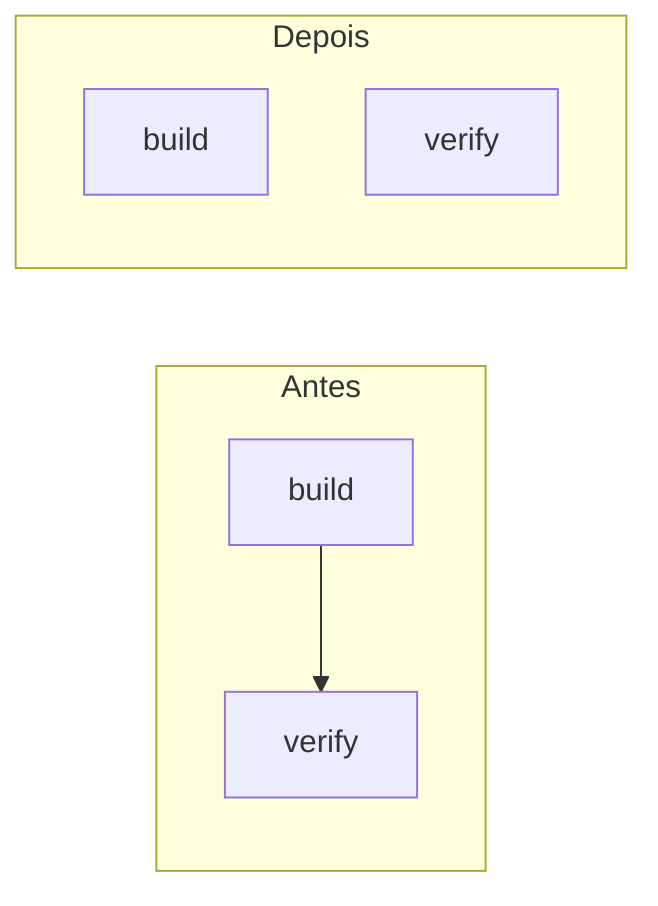

# Pipeline Impact

Analisador estático de workflows do GitHub Actions. Audita uma configuração ou
compara duas versões, apresentando diagnósticos, oportunidades de revisão e a
cobertura do modelo.

Desenvolvido como protótipo de um TCC em Engenharia de Software.

**Ferramenta:** 0.2.0 · **Contrato JSON:** 0.3 · **Python:** 3.11 ou superior.

## Exemplo

Um workflow produz o artefato `app` no job `build` e faz seu download em `verify`.
Uma alteração remove `needs: build` de `verify`:



O analisador identifica a mudança e conserva a relação de dados entre os jobs.
Na versão modificada, aponta que a precedência do produtor deixou de ser
garantida. Esse é o [caso de desenvolvimento 03](cases/03-artefato-sem-ordem).

Auditar `after.yml` apresenta **1 alerta `R02_ARTIFACT_ORDER`**, localizado no job
`verify`, step 2. A posição conta os steps na lista a partir de 1. O download
pode ocorrer antes da disponibilização do artefato.

Comparar `before.yml` com `after.yml` acrescenta **2 registros de mudança** que
descrevem a dependência direta e o alcance transitivo.

## Instalação

Execute os comandos na raiz do repositório.

### Windows com PowerShell

```powershell
python -m venv .venv
.\.venv\Scripts\python.exe -m pip install -r requirements-repro.txt
.\.venv\Scripts\python.exe -m pip install -e .
```

### Linux e macOS

```bash
python3 -m venv .venv
.venv/bin/python -m pip install -r requirements-repro.txt
.venv/bin/python -m pip install -e .
```

O arquivo de requisitos fixa a versão de PyYAML utilizada no desenvolvimento.
O pacote instala a entrada `pipeline-impact`; os exemplos usam o interpretador
do ambiente para tornar explícita a instalação utilizada.

## Auditar um workflow

No PowerShell:

```powershell
.\.venv\Scripts\python.exe -m pipeline_impact audit `
    cases/03-artefato-sem-ordem/after.yml `
    --output reports/auditoria
```

No Linux ou macOS:

```bash
.venv/bin/python -m pipeline_impact audit \
    cases/03-artefato-sem-ordem/after.yml \
    --output reports/auditoria
```

A auditoria apresenta um grafo, os achados e a cobertura do workflow informado.

## Comparar duas versões

No PowerShell:

```powershell
.\.venv\Scripts\python.exe -m pipeline_impact `
    --before cases/03-artefato-sem-ordem/before.yml `
    --after cases/03-artefato-sem-ordem/after.yml `
    --output reports/comparacao
```

No Linux ou macOS:

```bash
.venv/bin/python -m pipeline_impact \
    --before cases/03-artefato-sem-ordem/before.yml \
    --after cases/03-artefato-sem-ordem/after.yml \
    --output reports/comparacao
```

Ambos os modos gravam `report.json` e `report.md` em `reports/latest` por padrão.
O Markdown inclui grafos Mermaid, que precisam de um visualizador compatível.
As mesmas arestas estão disponíveis no JSON. Os relatórios gerados permanecem
fora do versionamento.

Consulte `python -m pipeline_impact --help` ou
`python -m pipeline_impact audit --help` com o interpretador do ambiente. No
Windows, `demo.ps1` audita o caso 03 usando o ambiente `.venv`.

## O que a versão atual analisa

| Capacidade | Resultado |
|---|---|
| Leitura de YAML | Exige UTF-8 e conteúdo serializável em JSON; preserva `on` e verifica estruturas, dependências e ciclos |
| Auditoria individual | Apresenta grafo, achados, cenários e cobertura de um workflow |
| Comparação de versões | Registra mudanças em jobs, dependências, condições e propriedades acompanhadas |
| Alcance no grafo | Identifica relações transitivas e descendentes potencialmente afetados |
| Artefatos reconhecidos | Verifica precedência entre uploads e downloads de mesmo nome literal |
| Condições suportadas | Procura consumo ativo com uploads anteriores pulados em cenários delimitados |
| Revisão do paralelismo | Examina a remoção hipotética de uma dependência, considerando relações de dados reconhecidas |

A análise é estática. A branch `laboratorio/auditoria` usa a CLI para auditar
workflows alterados em PRs de laboratório. A comparação automática e o histórico
ficam para os próximos marcos. [Roteiro do piloto](docs/PILOTO-AUDITORIA.md).

## Como interpretar o resultado

- `mode` identifica `audit` ou `compare`.
- `analysis.findings` reúne os achados do workflow auditado.
- `changes` descreve diferenças entre as configurações no modo `compare`.
- `after.findings` reúne os diagnósticos atuais da versão modificada.
- `location` indica o job e o step do consumo ou o campo `needs` a revisar.
- `warning` indica inconsistência ou risco sob as premissas do modelo.
- `opportunity` indica um ponto de revisão, com verificação experimental necessária.
- `coverage` registra o escopo, a situação e os motivos de cada análise.
- `limitations` informa restrições encontradas durante a análise.

O contrato 0.3 acrescenta modo, localização e cobertura aos campos da comparação.
As evidências e os IDs dos achados permanecem compatíveis com o contrato 0.2.
O Markdown explica onde está o achado, qual evidência o sustenta, sua possível
consequência e o que revisar. Consulte os escopos de `coverage` antes de
interpretar uma análise sem alertas.

### Códigos de saída

| Código | Significado |
|---|---|
| `0` | Análise concluída; o modo padrão permite alertas |
| `1` | Com `--fail-on-warning`, existe um `warning` no workflow auditado ou na versão modificada da comparação |
| `2` | Erro de entrada, argumentos ou arquivo |

Com apenas oportunidades, o código de saída continua `0`. O código `0` não
certifica a correção completa da pipeline.

## Desenvolvimento

```powershell
.\.venv\Scripts\python.exe -m unittest discover -s tests -v
.\.venv\Scripts\python.exe scripts/run_cases.py
.\.venv\Scripts\python.exe scripts/verify.py
```

No Linux ou macOS, substitua o executável por `.venv/bin/python`.

O repositório contém testes da implementação e **12 pares sintéticos de
workflows**, com expectativas em `case.json` e `cases/catalog.json`. Esses
materiais pertencem ao desenvolvimento; não representam uma avaliação
independente da eficácia científica. Nenhum desses comandos executa os comandos
dos workflows analisados.

## Documentação

| Leitura | Conteúdo |
|---|---|
| [Arquitetura](docs/ARQUITETURA.md) | Módulos, fluxo de dados, grafo e interpretador de condições |
| [Regras e relatório](docs/REGRAS-E-RELATORIO.md) | Diagnósticos, campos JSON, exemplos e códigos de saída |
| [Limitações](docs/LIMITACOES-DO-PROTOTIPO.md) | Catálogo com identificadores estáveis e consequências práticas |
| [Desenvolvimento](docs/DESENVOLVIMENTO.md) | Testes, casos, scripts e padrão de escrita do código |
| [Próximos passos](docs/PROXIMOS-PASSOS.md) | Próximo marco de integração experimental com GitHub Actions |

## Estrutura

```text
src/pipeline_impact/   Núcleo de análise, CLI e apresentação
tests/                Testes organizados por responsabilidade
cases/                Workflows e expectativas de desenvolvimento
scripts/              Regeneração dos casos e verificações locais
docs/                 Documentação técnica do protótipo
pyproject.toml        Instalação e metadados do pacote
requirements-repro.txt
demo.ps1              Auditoria de exemplo em PowerShell
```

O suporte é parcial: nomes dinâmicos de artefatos, actions personalizadas,
matrizes, workflows reutilizáveis, grupos de concorrência e partes da linguagem
de expressões podem ficar fora da análise. Consulte o catálogo antes de utilizar
os alertas como critério de bloqueio de uma CI.
