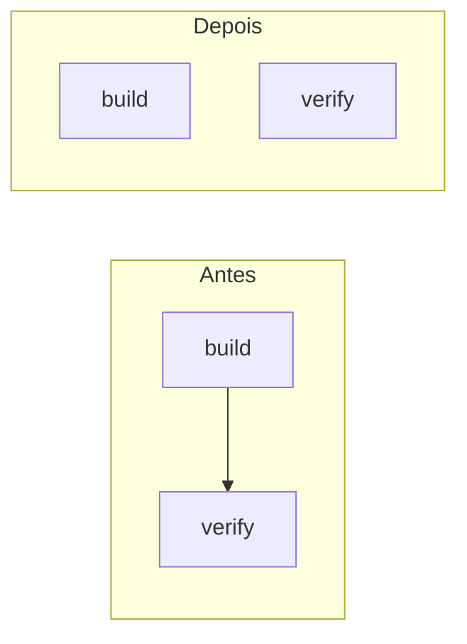

# Pipeline Impact

Analisador estático de alterações em workflows do GitHub Actions. Compara duas
configurações, explica mudanças nas dependências entre jobs e apresenta alertas e
oportunidades de revisão acompanhados de evidências.

Desenvolvido como protótipo de um TCC em Engenharia de Software.

**Ferramenta:** 0.1.0 · **Contrato JSON:** 0.2 · **Python:** 3.11 ou superior.

## Exemplo

Um workflow produz o artefato `app` no job `build` e faz seu download em `verify`.
Uma alteração remove `needs: build` de `verify`:



O analisador identifica a mudança e conserva a relação de dados entre os jobs.
Na versão modificada, aponta que a precedência do produtor deixou de ser
garantida. Esse é o [caso de desenvolvimento 03](cases/03-artefato-sem-ordem).

Resultado esperado: **2 registros de mudança e 1 alerta `R02_ARTIFACT_ORDER`**.
Os registros descrevem a dependência direta e o alcance transitivo; não são dois
defeitos distintos. O alerta representa um risco no modelo, não a afirmação de
que toda execução real falhará.

## Instalação

Execute os comandos na raiz do repositório.

### Windows com PowerShell

```powershell
python -m venv .venv
.\.venv\Scripts\python.exe -m pip install -r requirements-repro.txt
.\.venv\Scripts\python.exe -m pip install -e .
```

### Linux e macOS

```bash
python3 -m venv .venv
.venv/bin/python -m pip install -r requirements-repro.txt
.venv/bin/python -m pip install -e .
```

O arquivo de requisitos fixa a versão de PyYAML utilizada no desenvolvimento.
O pacote instala a entrada `pipeline-impact`; os exemplos usam o interpretador
do ambiente para tornar explícita a instalação utilizada.

## Primeira análise

No PowerShell:

```powershell
.\.venv\Scripts\python.exe -m pipeline_impact `
    --before cases/03-artefato-sem-ordem/before.yml `
    --after cases/03-artefato-sem-ordem/after.yml `
    --output reports/exemplo
```

No Linux ou macOS:

```bash
.venv/bin/python -m pipeline_impact \
    --before cases/03-artefato-sem-ordem/before.yml \
    --after cases/03-artefato-sem-ordem/after.yml \
    --output reports/exemplo
```

A pasta de saída receberá `report.json` e `report.md`. O Markdown inclui os
grafos em Mermaid, que precisam de um visualizador compatível. As mesmas arestas
estão disponíveis no JSON. Os arquivos gerados permanecem fora do versionamento.

Para consultar os argumentos, use `python -m pipeline_impact --help` com o
interpretador do ambiente. No Windows, `demo.ps1` demonstra o caso de upload
condicional usando o ambiente `.venv`.

## O que a versão atual analisa

| Capacidade | Resultado |
|---|---|
| Leitura de YAML | Exige UTF-8 e conteúdo serializável em JSON; preserva `on` e verifica estruturas, dependências e ciclos |
| Comparação de versões | Registra mudanças em jobs, dependências, condições e propriedades acompanhadas |
| Alcance no grafo | Identifica relações transitivas e descendentes potencialmente afetados |
| Artefatos reconhecidos | Verifica precedência entre uploads e downloads de mesmo nome literal |
| Condições suportadas | Procura consumo ativo com uploads anteriores pulados em cenários delimitados |
| Revisão do paralelismo | Examina a remoção hipotética de uma dependência, considerando relações de dados reconhecidas |

A análise lê configurações; não executa seus comandos ou actions. Não coleta
histórico, não obtém versões de um PR e não gera um novo YAML nesta versão.

## Como interpretar o resultado

- `changes` descreve diferenças entre as configurações.
- `after.findings` reúne os diagnósticos atuais da versão modificada.
- `warning` indica inconsistência ou risco sob as premissas do modelo.
- `opportunity` indica um ponto de revisão, com verificação experimental necessária.
- `limitations` informa algumas restrições encontradas; uma lista vazia não
  comprova cobertura completa.

O relatório não classifica achados como novos, persistentes ou resolvidos.
Encontrar uma diferença e um alerta na mesma comparação não comprova causalidade.
Pares sem ordem imposta por `needs` também não comprovam paralelismo observado.

### Códigos de saída

| Código | Significado |
|---|---|
| `0` | Análise concluída; o modo padrão permite alertas |
| `1` | Com `--fail-on-warning`, existe um `warning` na versão modificada |
| `2` | Erro de entrada, argumentos ou arquivo |

Oportunidades não fazem `--fail-on-warning` retornar `1`. O código `0` não
certifica a correção completa da pipeline.

## Desenvolvimento

```powershell
.\.venv\Scripts\python.exe -m unittest discover -s tests -v
.\.venv\Scripts\python.exe scripts/run_cases.py
```

No Linux ou macOS, substitua o executável por `.venv/bin/python`.

O repositório contém testes da implementação e **12 pares sintéticos de
workflows**, com expectativas em `case.json` e `cases/catalog.json`. Esses
materiais pertencem ao desenvolvimento; não representam uma avaliação
independente da eficácia científica. Nenhum desses comandos executa os comandos
dos workflows analisados.

## Documentação

| Leitura | Conteúdo |
|---|---|
| [Arquitetura](docs/ARQUITETURA.md) | Módulos, fluxo de dados, grafo e interpretador de condições |
| [Regras e relatório](docs/REGRAS-E-RELATORIO.md) | Diagnósticos, campos JSON, exemplos e códigos de saída |
| [Limitações](docs/LIMITACOES-DO-PROTOTIPO.md) | Catálogo com identificadores estáveis e consequências práticas |
| [Desenvolvimento](docs/DESENVOLVIMENTO.md) | Testes, casos, scripts e padrão de escrita do código |
| [Próximos passos](docs/PROXIMOS-PASSOS.md) | Próximo marco de integração experimental com GitHub Actions |

## Estrutura

```text
src/pipeline_impact/   Núcleo de análise, CLI e apresentação
tests/                Testes organizados por responsabilidade
cases/                Workflows e expectativas de desenvolvimento
scripts/              Regeneração dos casos e verificações locais
docs/                 Documentação técnica do protótipo
pyproject.toml        Instalação e metadados do pacote
requirements-repro.txt
demo.ps1              Demonstração local em PowerShell
```

O suporte é parcial: nomes dinâmicos de artefatos, actions personalizadas,
matrizes, workflows reutilizáveis, grupos de concorrência e partes da linguagem
de expressões podem ficar fora da análise. Consulte o catálogo antes de utilizar
os alertas como critério de bloqueio de uma CI.
