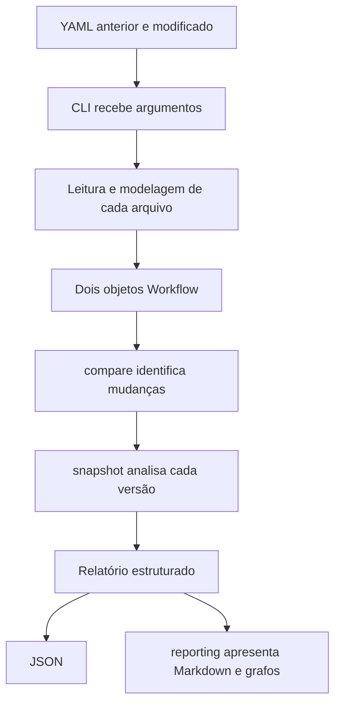

# Arquitetura

O Pipeline Impact recebe dois arquivos locais de workflow e produz uma
comparação estruturada. Os módulos distinguem entrada, modelagem, interpretação
de condições, análise e apresentação.

Esta documentação descreve a ferramenta 0.1.0 e o contrato JSON 0.2. Histórico,
seleção automática de versões Git e integração com Actions são extensões
previstas, detalhadas nos [próximos passos](PROXIMOS-PASSOS.md).

## Fluxo de processamento

`compare()` reúne diferenças e chama `snapshot()` para as duas configurações.
Cada snapshot contém relações, diagnósticos e limitações daquela configuração.
O relatório distingue esses diagnósticos das mudanças encontradas entre versões.

## Responsabilidades

| Módulo | Responsabilidade |
|---|---|
| [cli.py](../src/pipeline_impact/cli.py) | Interpretar argumentos, carregar entradas e gravar relatórios |
| [model.py](../src/pipeline_impact/model.py) | Ler e normalizar YAML, verificar a estrutura suportada e oferecer consultas ao grafo |
| [conditions.py](../src/pipeline_impact/conditions.py) | Interpretar o subconjunto de condições e calcular estados no modelo |
| [analyzer.py](../src/pipeline_impact/analyzer.py) | Comparar versões, reconhecer relações e aplicar verificações |
| [reporting.py](../src/pipeline_impact/reporting.py) | Apresentar os resultados e os grafos em Markdown |
| [__main__.py](../src/pipeline_impact/__main__.py) | Encaminhar `python -m pipeline_impact` para a CLI |

Os relatórios são gerados a partir dos resultados da análise. A apresentação não
executa novamente as regras nem modifica os workflows de entrada.

## Modelo e grafo

O objeto `Workflow` conserva a origem, o YAML lido, os jobs normalizados, uma
ordenação topológica e as limitações identificadas na modelagem. A normalização
transforma, por exemplo, `needs: build` em uma lista de dependências.

Os arquivos devem usar UTF-8, com ou sem BOM. O carregador restringe o conteúdo
a valores serializáveis em JSON, rejeitando datas YAML implícitas, binários,
conjuntos, números não finitos e aliases recursivos. Uma data escrita entre
aspas permanece texto e pode ser aceita. Essa fronteira não constitui validação
completa da linguagem do GitHub Actions.

Cada job corresponde a um vértice. A aresta `build -> verify` significa que
`verify` depende de `build`. Dependências inexistentes e ciclos são rejeitados
no subconjunto validado. A ordenação topológica permite processar pré-requisitos
antes dos dependentes no modelo; ela não representa o calendário de um runner.

`ancestors()` e `descendants()` usam busca em profundidade com uma pilha. A
primeira encontra pré-requisitos diretos e transitivos. A segunda encontra jobs
posteriores potencialmente afetados. A comparação reúne descendentes das duas
versões para informar o alcance estrutural de uma mudança.

## Relações de dados

`artifact_steps()` reconhece uploads e downloads nas actions oficiais
`actions/upload-artifact` e `actions/download-artifact`. O vínculo é feito por
igualdade do nome literal individual do artefato.

`precedes()` examina a posição dos steps quando produtor e consumidor pertencem
ao mesmo job. Entre jobs, consulta os ancestrais do consumidor. Assim, uma
precedência transitiva pode ser suficiente mesmo sem uma aresta direta.

Referências textuais no formato `needs.job.outputs.nome` também produzem pares
de jobs relacionados por dados. Essa busca não valida a existência do output
nem cobre todas as formas de acesso. As relações reconhecidas restringem as
sugestões de revisão de dependências; elas não descrevem todos os efeitos de
scripts, actions personalizadas ou serviços externos.

## Condições e indeterminação

O interpretador é determinístico e não utiliza aprendizado de máquina. A função
`evaluate()` recebe uma expressão, um dicionário de contexto e um estado de
sucesso. Os resultados possíveis são `True`, `False` e `None`, este último
representando indeterminação. Construções não suportadas geram uma restrição
tratada pela análise de estados.

O analisador utiliza três cenários predefinidos: push na `main`, push em uma
branch de exemplo e pull request com referência de merge de exemplo. Apenas
eventos simples compatíveis são considerados. Configurações não vazias de
eventos suspendem a análise contextual.

Esses valores não são coletados do ambiente de execução. O modelo pressupõe
sucesso dos comandos ativos e não reproduz integralmente falhas, cancelamentos
ou seus efeitos. Consulte LIM-011 a LIM-019 no [catálogo](LIMITACOES-DO-PROTOTIPO.md).

## Comparação e recomendações

A comparação acompanha jobs, `needs`, alcance transitivo, `if`,
`continue-on-error`, steps, outputs e mudanças em campos não interpretados.
As verificações de artefatos e de revisão do paralelismo são feitas em cada
snapshot. O relatório não atribui automaticamente a causa de um alerta à mudança.

A revisão de paralelismo remove hipoteticamente uma aresta de uma cópia do
grafo. A sugestão é descartada se outro caminho mantiver a mesma ordem ou se a
remoção romper uma precedência que sustentava uma relação de dados reconhecida.
Nenhum YAML é reescrito. A ausência de relação reconhecida não comprova
independência entre jobs.

O [guia de regras e relatório](REGRAS-E-RELATORIO.md) descreve cada resultado e
seu significado. O [catálogo de limitações](LIMITACOES-DO-PROTOTIPO.md) registra
os limites técnicos e as escolhas de escopo.
