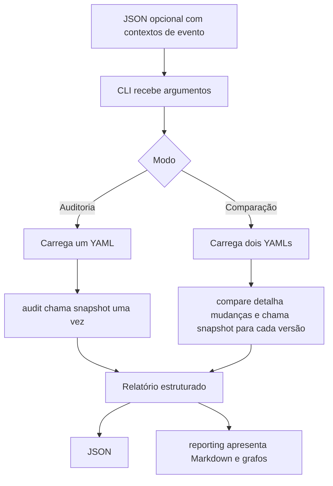

# Arquitetura

O Pipeline Impact audita um workflow local ou compara duas versões. Os módulos
distinguem entrada, modelagem, interpretação de condições, análise e
apresentação.

Esta documentação descreve a ferramenta 0.3.0 e o contrato JSON 0.4. O GitHub
Actions aciona a auditoria dos workflows alterados em PRs e fornece o contexto
do evento. A seleção automática de versões para comparação e a coleta de
histórico estão previstas em etapas posteriores. [Próximos passos](PROXIMOS-PASSOS.md).

## Fluxo de processamento

`audit()` usa um snapshot em `analysis`. `compare()` reúne diferenças em
`changes`, detalha mudanças de steps em `step_changes` e registra os snapshots
em `before` e `after`. Cada snapshot contém relações, avaliações dos contextos
informados, diagnósticos, cobertura e limitações da configuração.

## Responsabilidades

| Módulo | Responsabilidade |
|---|---|
| [cli.py](../src/pipeline_impact/cli.py) | Identificar o modo, carregar entradas e gravar relatórios |
| [model.py](../src/pipeline_impact/model.py) | Ler e normalizar YAML, verificar a estrutura suportada e oferecer consultas ao grafo |
| [conditions.py](../src/pipeline_impact/conditions.py) | Interpretar o subconjunto de condições e calcular estados no modelo |
| [event_context.py](../src/pipeline_impact/event_context.py) | Validar os contextos de entrada e verificar sua elegibilidade perante os gatilhos |
| [needs_references.py](../src/pipeline_impact/needs_references.py) | Localizar referências literais a outputs e resultados em expressões de jobs e steps |
| [analyzer.py](../src/pipeline_impact/analyzer.py) | Auditar, comparar, aplicar verificações e registrar a cobertura |
| [step_comparison.py](../src/pipeline_impact/step_comparison.py) | Estabelecer a correspondência entre steps e descrever mudanças por job |
| [reporting.py](../src/pipeline_impact/reporting.py) | Apresentar os resultados e os grafos em Markdown |
| [__main__.py](../src/pipeline_impact/__main__.py) | Encaminhar `python -m pipeline_impact` para a CLI |

O módulo de apresentação usa os resultados calculados para montar os grafos,
as explicações dos achados e a seção de cobertura. A CLI grava o JSON e o
Markdown na pasta de saída.

## Modelo e grafo

O objeto `Workflow` conserva a origem, o YAML lido, os jobs normalizados, uma
ordenação topológica e as limitações identificadas na modelagem. A normalização
transforma, por exemplo, `needs: build` em uma lista de dependências.

Os arquivos devem usar UTF-8, com ou sem BOM. O carregador restringe o conteúdo
a valores serializáveis em JSON, rejeitando datas YAML implícitas, binários,
conjuntos, números não finitos e aliases recursivos. Uma data escrita entre
aspas permanece texto e pode ser aceita. Essa fronteira não constitui validação
completa da linguagem do GitHub Actions.

Cada job corresponde a um vértice. A aresta `build -> verify` significa que
`verify` depende de `build`. Dependências inexistentes e ciclos são rejeitados
no subconjunto validado. A ordenação topológica permite processar pré-requisitos
antes dos dependentes no modelo; ela não representa o calendário de um runner.

`ancestors()` e `descendants()` usam busca em profundidade com uma pilha. A
primeira encontra pré-requisitos diretos e transitivos. A segunda encontra jobs
posteriores potencialmente afetados. A comparação reúne descendentes das duas
versões para informar o alcance estrutural de uma mudança.

## Relações de dados

`artifact_steps()` reconhece uploads e downloads nas actions oficiais
`actions/upload-artifact` e `actions/download-artifact`. O vínculo é feito por
igualdade do nome literal individual do artefato.

`precedes()` examina a posição dos steps quando produtor e consumidor pertencem
ao mesmo job. Entre jobs, consulta os ancestrais do consumidor. Assim, uma
precedência transitiva pode ser suficiente mesmo sem uma aresta direta.

As expressões `needs.job.outputs.nome` e `needs.job.result` identificam um
produtor que deve constar nas dependências diretas do consumidor. A R06 verifica
essa declaração e localiza a referência. A R05 preserva as arestas usadas por
essas referências e a precedência de artefatos reconhecidos. A busca cobre
acessos literais e deixa de fora os valores produzidos e os efeitos de scripts,
actions personalizadas e serviços externos.

## Condições e indeterminação

O interpretador é determinístico e não utiliza aprendizado de máquina. A função
`evaluate()` recebe uma expressão, um dicionário de contexto e um estado de
sucesso. Os resultados possíveis são `True`, `False` e `None`, este último
representando indeterminação. Construções não suportadas geram uma restrição
tratada pela análise de estados.

Os contextos são fornecidos pela opção `--contexts`. O arquivo de exemplo em
`cases/contexts.json` contém três cenários sintéticos usados nas verificações
locais. Em uma execução da CLI sem contexto informado, a análise estrutural
continua e a R03 fica suspensa. Para cada contexto fornecido, a análise verifica
primeiro a elegibilidade do evento. Os eventos declarados sem filtros são
suportados. Para `push` e `pull_request`, o subconjunto inclui um único filtro
`branches` ou `branches-ignore` com nomes literais. Filtros e combinações fora
desse subconjunto resultam em elegibilidade indeterminada.

No Actions, o script de integração lê o nome e as referências do evento que
acionou a auditoria e entrega esse contexto à CLI. O contexto descreve o PR do
repositório que hospeda a auditoria. As referências podem ser diferentes das
usadas em outro repositório de origem do YAML. Os estados calculados descrevem
uma execução hipotética sob a premissa de sucesso dos comandos ativos.
[Detalhes da integração](PILOTO-AUDITORIA.md) ·
[Catálogo, LIM-013 a LIM-019](LIMITACOES-DO-PROTOTIPO.md).

## Comparação e recomendações

A comparação acompanha jobs, `needs`, alcance transitivo, `if`,
`continue-on-error`, steps, outputs e mudanças em campos não interpretados.

Quando a lista de steps de um job muda, a regra `STEP_CHANGE` registra a
alteração agregada. A comparação detalhada busca correspondências entre steps
do mesmo job e registra as mudanças em `step_changes`. A ordem relativa é
avaliada entre steps correspondentes de jobs sequenciais suportados. Quando
um `if` é alterado em um step identificado, os estados hipotéticos calculados
para cada contexto são reunidos no relatório de comparação.
As verificações de artefatos e de revisão do paralelismo são feitas em cada
snapshot. O relatório não atribui automaticamente a causa de um alerta à mudança.

A revisão de paralelismo remove hipoteticamente uma aresta de uma cópia do
grafo. A sugestão é descartada se outro caminho mantiver a mesma ordem ou se a
remoção romper uma precedência que sustentava uma relação de dados reconhecida.
Nenhum YAML é reescrito. A ausência de relação reconhecida não comprova
independência entre jobs.

O [guia de regras e relatório](REGRAS-E-RELATORIO.md) descreve cada resultado e
seu significado. O [catálogo de limitações](LIMITACOES-DO-PROTOTIPO.md) registra
os limites técnicos e as escolhas de escopo.
